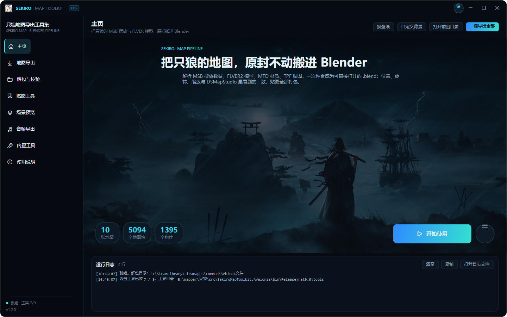
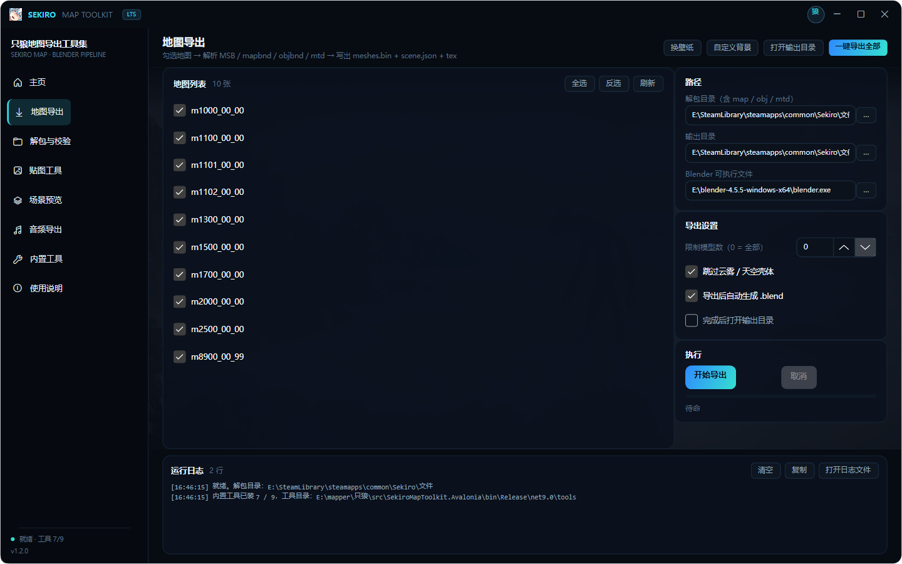
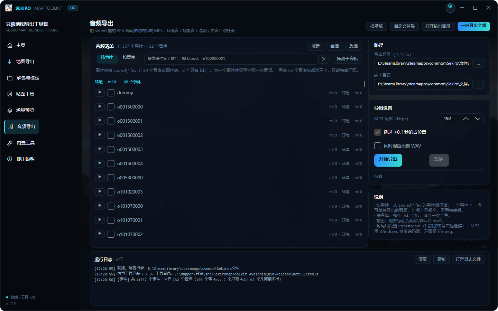
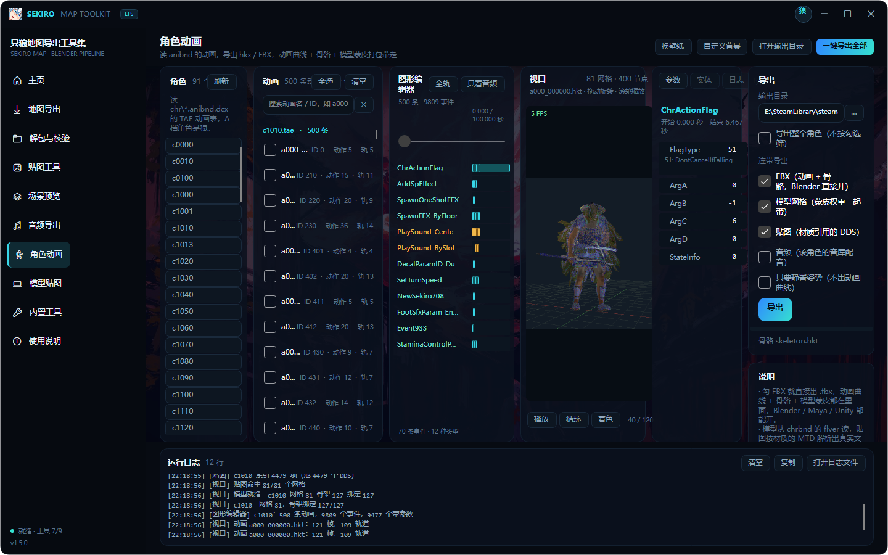
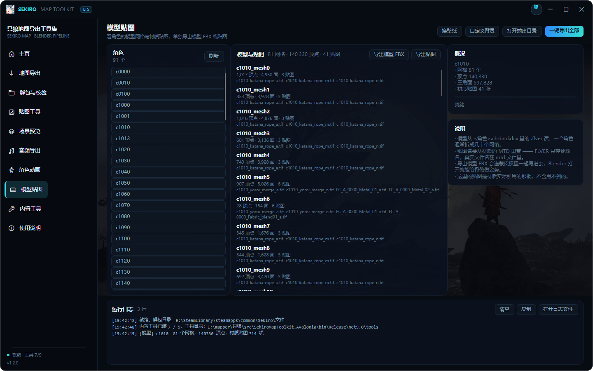
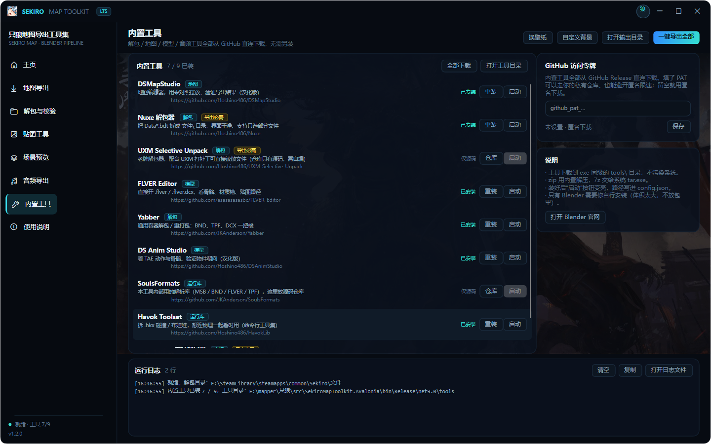

# 只狼地图导出工具集 · Sekiro Map Toolkit

把**解包后的只狼地图资源**（MSBS 摆放 + FLVER2 模型 + MTD 材质 + TPF 贴图）一键转成 **Blender 能直接打开的 `.blend`**。
物件的位置 / 旋转 / 缩放与 DSMapStudio 里看到的完全一致，贴图全部打包进 .blend，光源 / 碰撞 / 导航丢弃。

配套的**内置工具管理器**可以从 GitHub Release 直连下载解包器、地图编辑器、模型编辑器，不用一个个去翻链接。



---

## 功能

| 页面 | 做什么 |
|---|---|
| **主页** | 数据规模统计（地图 / 地图块 / 物件）、一键导出全部、右下悬浮「开始使用」 |
| **地图导出** | 勾地图 → 解析 MSB / mapbnd / objbnd / mtd → 写 `meshes.bin` + `scene.json` + `tex` → 调 Blender 出 `.blend` |
| **解包与校验** | 内置解包器一键下载启动，9 项完整性体检 |
| **贴图工具** | DDS 批量转不透明 PNG（丢 alpha、透明区颜色扩散，避免树叶纸片发黑） |
| **场景预览** | 读 `scene.json` 出统计，或让 Blender 渲一张缩略图（可一键设为软件背景） |
| **音频导出** | 双模式：**按事件**——从 `sound\*.fev` 读事件表，一条事件一条音频，可试听、可单独导出；**按音库**——整个 `.fsb` 全拆。环境 / 场景 / 混响 / 特殊 / 语音 / 角色 / 全局自动分类，加密音库也能直读 |
| **角色动画** | 读 `chr\*.anibnd.dcx` 的动画，91 个角色、单狼 2209 条动作；**内置图形编辑器**——按动画看 TAE 事件时间轴（事件类型 / 开始结束时间 / 全部参数），音频事件单独高亮，点一条事件直接看 `SoundType` `SoundID` 等参数，并一键跳去音频页找对应音轨；**内置 3D 视口**——模型带原始贴图站在地面网格上，播放/循环/着色三个按钮 + 帧滑块，参数/实体/日志三个标签页；按条导出 `.hkx` 原始关键帧，或**直接出 FBX**（动画曲线 + 骨骼 + 模型蒙皮一次打包）。可连带导出模型、贴图、该角色的配音 |
| **模型贴图** | 按角色浏览 `.flver` 拆出来的网格（顶点 / 面 / 贴图引用），单独导出模型 FBX 或材质贴图 |
| **内置工具** | DSMapStudio / Nuxe / UXM / FLVER Editor / Yabber / DS Anim Studio / SoulsFormats / Havok Toolset / vgmstream 全部 GitHub 直连下载，装好即启动 |
| **使用说明** | 流程、坐标约定、命令行参数、已知限制 |

**界面**：Avalonia 11 无边框圆角窗 + Fluent 暗色，左侧固定导航，每页配一张 1920×1080 手绘只狼插画（自动压暗保证文字可读），启动随机轮换、挂机每 4 分钟自动换图，也可以换成自己的图。







---

## 快速开始

### 1. 下载

去 [Releases](../../releases) 拿 `SekiroMapToolkit.exe`（自包含单文件，不用装 .NET），和 `oo2core_6_win64.dll` 放同一个目录。

> `oo2core_6_win64.dll` 是 Oodle 解压库，版权归 Epic Games，本仓库不附带；从你的只狼游戏目录或任意 Souls 工具包里拿一份，程序启动时也会自动从游戏根目录找。

### 2. 解包游戏

打开软件 →「解包与校验」→ 点 **下载并启动 Nuxe**（推荐）或 **UXM**：

1. Browse 指向 `sekiro.exe`
2. 点 Unpack；只想省空间就只勾 `map` / `obj` / `mtd`
3. 结果落在 `<游戏根>\文件\`，本工具默认指向这里

导出真正用到 4 样：

```
文件\map\mapstudio\m*.msb.dcx      摆放数据（哪些物件、在哪、怎么转）
文件\map\m*\m*_*.mapbnd.dcx        地图块模型（地形、建筑）
文件\obj\*.objbnd.dcx              场景物件模型（草木、宝箱、灯笼…）
文件\mtd\*.mtd                    材质定义（决定贴图槽位与默认贴图）
```

### 3. 导出

「地图导出」页确认三个路径（自动探测）→ 勾地图 → **开始导出**。
单张 m10 约 6900 物件 / 62 万网格实例 / 1180 万顶点，35 秒出数据、再做 `.blend` 约 740 MB。

### 4. 音频（可选）

「音频导出」页有两种模式，切换按钮在左上角。

**按事件**（推荐）：直接从 `sound\*.fev` 的事件表里读出 **11,357 条音频事件**，一个事件一行，勾哪条导哪条。

```
m10 · 环境 → a100000001 → ▶ 试听
m10 · 场景 → m100000001 → ▶ 试听
```

- 点 `▶` 就地试听，不用先导出（只解这一条，约 1 秒出声，再点一次停）。
- 勾好按「开始导出」，**只解勾中的那几条音轨**：`c1010` 全部 61 个事件 2.8 秒，`sm10` 22 条 11 秒。
- 输出用事件名当文件名，不再是一堆 `001_xxx.wav`。
- 搜索框支持按事件名 / 路径 / 音库 / 类别过滤，如 `blood`、`m100000001`、`sm10`。

**按音库**：老的整包模式，一个 `.fsb` 有多少子音轨就出多少 MP3，适合一次全导。

```
<解包目录>\map\临时文件夹\音频\
├─ m10\{环境,场景,混响,特殊,语音,角色,全局}\<音库>\事件名.mp3     按事件
└─ m10\环境\m10\001_ntc_m10_o001500000.mp3                        按音库
```

- **解码**用内置 [vgmstream](https://github.com/vgmstream/vgmstream)（首次自动下载，约 4 MB）。只狼那些头部被混淆过的 FSB5（`sm*` / `rm*` / `vm*_<语言>` / `xm*` / `smain`）它也能直接读，不用另外找密钥。
- **编码**走 Windows 自带的 Media Foundation MP3 编码器，**不需要装 ffmpeg**。非常见采样率（如 11000 Hz、8 声道）会自动重采样 / 降混成 44.1k/48k 立体声。
- 全量导出（按音库）：174 个音库 / 约 52,000 个子音轨，磁盘占用约 3.5 GB，耗时约 1 小时（可随时取消）。

| 类别 | 前缀 | 说明 |
|---|---|---|
| 环境 | `m*` | 地图环境音、风声水声 |
| 场景 | `sm*` | 场景音效与 BGM |
| 混响 | `rm*` | 环境混响层（多为 8 声道） |
| 特殊 | `xm*` | 特殊音效 / 过场 |
| 语音 | `vm*` | 人物语音，带 `_jaj`/`_enu`/`_frf`/`_iti`/`_ese`/`_ded` 语言后缀 |
| 角色 | `c*` | 角色 / 敌人音效 |
| 全局 | `main` `smain` | 全局音库 |

### 5. 角色动画（可选）

「角色动画」页读 `chr\*.anibnd.dcx` 里的 TAE 动画表：

- 左边列 **91 个有动画的角色**，`c0000` 是狼（65 个 `.tae` / **2,209 条动作**），`c1180`、`c1190` 等 Boss 也各有几百条。
- 中间按 `.tae` 分组列出每条动画的 **ID / 动作数 / 轨道数**，可搜索、可勾选。
- 「导出动画文件」把勾中的导出成一组文件：

```
<输出目录>\动画\c0000\
├─ a000_005000.hkx     这一条动画的关键帧
├─ a00.tae             动画表（哪个 ID 叫什么、多长、事件轨道）
└─ skeleton.hkt        骨骼
```

这些是只狼的原始格式，**直接丢进 [DSAnimStudio](https://github.com/Meiko-Z/DSAnimStudio) 就能看动作、转 FBX**（`File → Import`，选导出目录，按骨架挂钩）。

只狼的 TAE 是 SDT 格式、动画是 Havok 2016 的 TAG0 分片，格式解析用 [SoulsAssetPipeline](https://github.com/Meowmaritus/SoulsAssetPipeline)。

---

## 命令行

```bat
SekiroMapToolkit.exe --cli --root "E:\SteamLibrary\steamapps\common\Sekiro\文件" ^
  --out "E:\SteamLibrary\steamapps\common\Sekiro\文件\map\临时文件夹" ^
  --maps m10_00_00_00,m15_00_00_00 --blend
```

| 参数 | 含义 |
|---|---|
| `--root` | 解包目录（含 `map` / `obj` / `mtd`） |
| `--out` | 输出根目录 |
| `--maps` | 逗号分隔的地图名；省略或 `*` = 全部 |
| `--limit N` | 只导前 N 个模型（试跑用，0 = 全部） |
| `--blend` | 顺带生成 .blend |
| `--blender` | 指定 `blender.exe` |

### TAE 事件表：`--tae`

把角色的 TAE 事件（图形编辑器看的那份数据）打成文本或 CSV。

```bat
SekiroMapToolkit.exe --cli --tae --root "<解包目录>" --chr c1010 --sound-only
SekiroMapToolkit.exe --cli --tae --root "<解包目录>" --chr c0000 --csv tae.csv
```

| 参数 | 作用 |
|---|---|
| `--chr` | 角色，逗号分隔多个，省略 = `c0000` |
| `--find` | 只留动画 ID 含这个串的 |
| `--sound-only` | 只打音频事件（`PlaySound_*`） |
| `--csv <file>` | 同时写 CSV（列：角色/动画/type/名字/开始/结束/参数） |

实测：`c0000`（狼）1883 条动画、**70,410 个事件**、68,134 个带参数；
`c1010`（一心）500 条动画、9,809 个事件、9,477 个带参数。

内置工具也可以命令行装：

```bat
SekiroMapToolkit.exe --cli --tools --list          :: 看状态
SekiroMapToolkit.exe --cli --tools                 :: 装全部
SekiroMapToolkit.exe --cli --tools --only Nuxe,Yabber
```

音频也能命令行导：

```bat
:: 全部音库 → MP3
SekiroMapToolkit.exe --cli --audio --all

:: 只要 m10 / m11 两张图的环境音和场景音
SekiroMapToolkit.exe --cli --audio --maps m10,m11 --cats 环境,场景

:: 精确到音库名，顺便保留 WAV
SekiroMapToolkit.exe --cli --audio --banks sm10,vm10_jaj,main --bitrate 256 --keepwav
```

| 参数 | 含义 |
|---|---|
| `--sound` | 音库目录（含 `*.fsb`），默认 `<解包目录>\sound` |
| `--audio-out` | 音频输出目录，默认 `<输出目录>\音频` |
| `--maps` | 只导这些地图的音库（`m10`、`m11`…），`*` = 全部 |
| `--cats` | 只导这些类别（`环境,场景,混响,特殊,语音,角色,全局`） |
| `--banks` | 只导这些音库（`sm10,rm11`…） |
| `--bitrate` | MP3 码率，默认 192 |
| `--keepwav` | 同时保留无损 WAV |
| `--noskip` | 不要跳过 <0.1 秒的占位音 |

按事件导（只解勾中的那几条音轨，快很多）：

```bat
:: 先看看有哪些事件（不导出）
SekiroMapToolkit.exe --cli --events --dry

:: 只导 sm10 这一个音库的全部事件
SekiroMapToolkit.exe --cli --events --banks sm10

:: 名字里带 blood 的事件，全库范围找
SekiroMapToolkit.exe --cli --events --find blood

:: 只要 m10 场景音的 c1010 那一份
SekiroMapToolkit.exe --cli --events --banks c1010 --cats 场景
```

| 参数 | 含义 |
|---|---|
| `--events` | 进入按事件导出模式 |
| `--banks` | 只处理这些音库（`sm10,c1010`…） |
| `--cats` | 只处理这些类别（`环境,场景,混响,特殊,语音,角色,全局`） |
| `--find` | 事件名 / 路径包含这段文字（不区分大小写） |
| `--dry` | 只列出来，不导出 |
| `--keepwav` | 同时保留无损 WAV |

角色动画也能命令行导：

```bat
:: 有哪些角色有动画
SekiroMapToolkit.exe --cli --anims --dry

:: 狼的全部动画文件（按 TAE 分组）
SekiroMapToolkit.exe --cli --anims --chr c0000 --dry

:: 只导名字带 0050 的那几条
SekiroMapToolkit.exe --cli --anims --chr c1000 --find 0050

:: 整个角色一次导全
SekiroMapToolkit.exe --cli --anims --chr c0000 --raw

:: 直接出 FBX：骨架 + 动画曲线 + 模型蒙皮（Blender 能开）
SekiroMapToolkit.exe --cli --anims --chr c1010 --find a000_0000 --fbx --mesh

:: 再加贴图和该角色配音
SekiroMapToolkit.exe --cli --anims --chr c1010 --find a000_0000 --fbx --mesh --tex --with-audio

:: 只要模型 + 贴图，不要动画曲线
SekiroMapToolkit.exe --cli --anims --chr c1010 --mesh --tex --rest
```

| 参数 | 含义 |
|---|---|
| `--anims` | 进入动画导出模式 |
| `--chr` | 只处理这些角色（`c0000,c1180`…） |
| `--find` | 动画名 / ID 包含这段文字 |
| `--out` | 输出根目录，动画落在 `<out>\动画\<角色>\` |
| `--raw` | 整个角色全导（不按 `--find` 筛） |
| `--dry` | 只列出来，不导出 |
| `--fbx` | 直接写二进制 FBX（骨架 + 动画曲线 + 蒙皮），自动带上模型 |
| `--mesh` | 连模型网格一起写进 FBX |
| `--tex` | 连带导出材质引用的贴图 |
| `--with-audio` | 连带导出该角色音库的配音 |
| `--rest` | 只出静置姿势，不写动画曲线 |

日志落在 `<输出目录>\cli_export.log`、`<音频输出目录>\cli_audio.log`。

---

## 输出结构

```
<输出目录>\<地图名>\
├─ meshes.bin        每模型一份网格：顶点 / 法线 / UV / 索引，已是 Blender Z-up
├─ scene.json        材质表 + 每个物件的 loc / quat(w,x,y,z) / scale
├─ tex\*.dds         材质引用的原始贴图
└─ <地图名>.blend    最终场景（贴图已打包，换电脑也不丢图）
```

角色导出（动画页勾 FBX，或 `--anims --fbx`）：

```
<输出目录>\动画\<角色>\
├─ fbx\a000_000210.fbx   动画曲线 + 骨架 + 模型蒙皮，一个文件全带走
├─ fbx\<角色>_rest.fbx   静置姿势（勾「只要静置姿势」或该角色没动画时）
├─ tex\*.dds             材质实际引用的贴图
└─ audio\*.mp3           该角色音库的配音（勾「音频」时）
```

- `meshes.bin` 的网格**按模型去重**，物件靠 `scene.json` 的变换重复引用 —— 7000+ 物件、1800 万面还能秒开的关键。
- **坐标**：MSB 是 X 右 / Y 前 / Z 上，Blender 是 X 右 / Y 进屏 / Z 上，导出统一做 `(x, z, -y)`，四元数按 `(w,x,y,z)` 写入。不要再改轴向。
- **材质**：albedo → Base Color（sRGB），normal → Normal Map（Non-Color），Roughness 0.75 / Metallic 0，双面不剔除。
- **贴图**：DDS 在建模阶段转成不透明 RGB PNG，透明像素用邻域扩散填充。

---

## 从源码编译

需要 .NET 9 SDK（或更新的 10）。

```bat
git clone https://github.com/Hoshino486/SekiroMapToolkit.git
cd SekiroMapToolkit\src\SekiroMapToolkit.Avalonia

dotnet publish -c Release -r win-x64 --self-contained true ^
  -p:PublishSingleFile=true -p:IncludeNativeLibrariesForSelfExtract=true ^
  -p:EnableCompressionInSingleFile=true -o ..\..\_publish
```

产物 `_publish\SekiroMapToolkit.exe`（约 50 MB）。

### 工程结构

```
src\SekiroMapToolkit\Core\          导出引擎（与界面无关，两套 UI 共用）
  SekiroExporter.cs   MSB/FLVER 解析、网格写出、贴图解析、变换计算
  HavokAnimation.cs   TAG0 标记文件解析 → 骨架 / 动画曲线（依赖 compendium）
  FbxAnimWriter.cs    手写二进制 FBX 7.4：骨骼 / 蒙皮 / 动画曲线 / 网格
  CharacterAssets.cs  按角色读 flver 网格、MTD 贴图解析、骨架、动画
  CharacterExport.cs  动画 + 模型 + 贴图 + 音频的一体化导出
  EventAudio.cs       把角色音库的配音接到导出流程里
  Axis.cs             坐标轴与四元数
  Souls.cs            TextureResolver / MtdBank
  BlenderRunner.cs    调 Blender 跑脚本、流式日志、取消即杀进程
  AudioExporter.cs    FSB 归类 + vgmstream 解码 + MediaFoundation 转 MP3（按音库）
  FevParser.cs        FEV 事件工程解析：STRR 音轨路径、LGCY 分组、PROP/EPRP 参数
  FsbNames.cs         直接读 FSB5 name table，拿子音轨名（不解码）
  EventLibrary.cs     「事件 → 音轨」索引 + 按事件导出 + 试听调度
  TaeEvents.cs        TAE 事件解析：套 DSAnimStudio 的 TAE 模板解出每个事件的具名参数
  SoftRenderer.cs     纯软件 3D 渲染器（z-buffer 光栅化，不依赖 OpenGL/DirectX）
  SkinSolver.cs       蒙皮求解器：算法照抄 DSAnimStudio（顶点索引是 FLVER 节点索引，不是 hkx 骨骼索引）
  AnimPose.cs         旧版骨架姿势求解（视口已改用 SkinSolver）
  AudioPreview.cs     单条子音轨试听（vgmstream 解一条 → WaveOut 播 → 播完自清）
  AnimationLibrary.cs anibnd/TAE 动画表解析 + 按条导出 hkx/tae/骨骼
  Config.cs           config.json 读写与路径/工具自动探测
  ToolCatalog.cs      内置工具清单 + GitHub Release 下载 / 解压
  Oodle.cs            oo2core 自愈（预加载 + PATH 注入，换工作目录也能找到）
src\SekiroMapToolkit.Avalonia\      Avalonia 界面
  App.axaml           全局色令牌
  Styles\Theme.axaml  全部控件样式
  MainWindow.axaml    窗口骨架 + 10 个页面
  MainWindow.axaml.cs 导航与所有交互
  Cli.cs              无界面命令行（--cli / --tools / --audio / --events / --anims）
  Resources\bg\       20 张内置壁纸（1920×1080）
scripts\            Blender 侧脚本（必须与 exe 同级）
  build_blend.py      meshes.bin + scene.json + tex → .blend
  convert_dds.py      DDS → 不透明 PNG
  render_preview.py   全局缩略图
  focus_render.py     特写渲染
```

自检：`SekiroMapToolkit.exe --shot out.png --page 1` 把指定页面渲成 PNG。

---

## 常见问题

| 现象 | 原因 / 处理 |
|---|---|
| `NoOodleFoundException` | 缺 `oo2core_6_win64.dll`，放 exe 旁边 |
| 提示「找不到 msb」 | `--root` 指错，或没解包 `map/mapstudio` |
| 物件挤成一坨 / 镜像 | `scene.json` 的 quat 被改过顺序，必须保持 `(w,x,y,z)` |
| 贴图缺一堆 | `obj` 的 TPF 名和材质路径对不上，先跑「完整性校验」 |
| .blend 打不开 / 卡死 | 用 Blender 4.2+，且命令行 `-b` 模式跑 |
| 内存爆 | 单张 m10 约 1800 万顶点，用 `--limit` 试跑或分批导 |
| 音频导出报「系统没有可用的 MP3 编码器」 | Windows 精简版可能缺 Media Foundation；用 `--keepwav` 先出 WAV，或用完整版系统 |
| 音频导出有很多 0 秒文件 | 游戏里本来就带一堆占位静音轨，默认已跳过（`跳过 <0.1 秒的占位音`） |
| 按事件模式下有些事件灰着（显示「音库中缺失」） | `fev` 里登记了这一轨但对应 `.fsb` 里没有；`main` 里典型，属游戏自身数据，不是解析错 |
| 事件里看不到 `vm*` 语音 | 语音包只有 `.fsb` 没有 `.fev`，没有事件表；这些会以 `bank#序号` 形式列出，按音库模式导更合适 |
| 动画导出的 `.hkx` 只有几 KB | 正常：TAE 里每条动画就是一小段 Havok 分片，完整动作由 DSAnimStudio 按骨架合并播放 |
| 动画页某个角色 0 条 | 该 `anibnd` 里没有动画数据（`c0010`、`c0100` 等就是这样） |
| 模型贴图页某个角色 0 网格 | 该角色的 `chrbnd` 里 flver 不含网格（`c0000` 就是这样），换 `c1010` 之类看 |
| 导出的 FBX 在 Blender 里没蒙皮 | 旧版本的问题；1.3.0 起 Cluster 的连接方向和 `TransformLink` 绑定矩阵都已修正 |
| 工具下载 404 | Release 资产改名了，去对应仓库 `/releases` 看一眼；填 GitHub PAT 可避开限速 |

---

## 已知限制

- 只导**模型 + 贴图 + 摆放**；光源、碰撞体、导航、事件、敌人参数一律不导。
- 云雾 / 天空壳体默认跳过（不透明雾壳会把整个场景挡死），可在设置里取消。
- 材质只做 Principled 近似（albedo + normal + 固定粗糙度），不还原游戏 shader 的视差、遮罩、顶点色细节。
- `m89_00_00_99` 是空测试图，导出来基本没东西，属正常。
- **音频事件**：62 个音库的 FSB5 头被混淆（`sm*` / `rm*` / `vm*` / `smain` 等），名字表读不出来，这些事件的定位靠 FEV 的轨道路径 + vgmstream 整库解后按名字匹配，比精确轨定位慢（一个库约 10 秒）。语音（`vm*`）本来就没有 `.fev`，只能按子音轨序号导。
- `.itl` 是音量限制器参数，不含事件信息，不解析。
- **动画**：两条路都给。勾「FBX」就在内部直接写出二进制 FBX 7.4 —— 骨架、动画曲线、模型网格、蒙皮权重一次打包，Blender / Maya / Unity 直接打开（已在 Blender 4.5 上验证：127 骨、81 网格、140,237 个带权重顶点、1070 条 F-Curve）。不勾就走原始 `.hkx` 导出，给 DSAnimStudio 用。
- **FBX 的坐标**：只狼是左手 Y-up，FBX 按 Y-up 输出，旋转以欧拉 XYZ 写入并做了连续性展开，不会出现 ±180° 翻转抽搐。
- **音频与动画的对应**：动画名（`a000_000210`）和音效事件名（`a100000001`）编号体系不同，没法逐条精确配对。所以「连带导出音频」做的是**按角色音库整包带出**（`sound\c1010.fev` / `.fsb`），是这个角色的配音集合，不是某一条动画的专属音效。
- **模型贴图的解析**：FLVER 里只存贴图**参数名**（`Character_AMSN_snp_Texture2D_2_AlbedoMap_0`），真实文件名在材质的 `.mtd` 里。所以贴图要靠 MTD 查表才能拿到，直接用 FLVER 的 `Path` 字段会是空的。
- **`c0000`（狼）的模型是空的**：`c0000.chrbnd.dcx` 里那个 124 KB 的 flver 不含网格，狼的可见模型是按部件拼的。要看实际模型请选 `c1010`（一心）、`c1020` 这类角色。
- 壁纸为网络收集的同人插画，版权归原作者，仅供界面装饰。

## 许可

代码 MIT。只狼资源版权归 FromSoftware / 动视所有，本工具不附带任何游戏资产。
