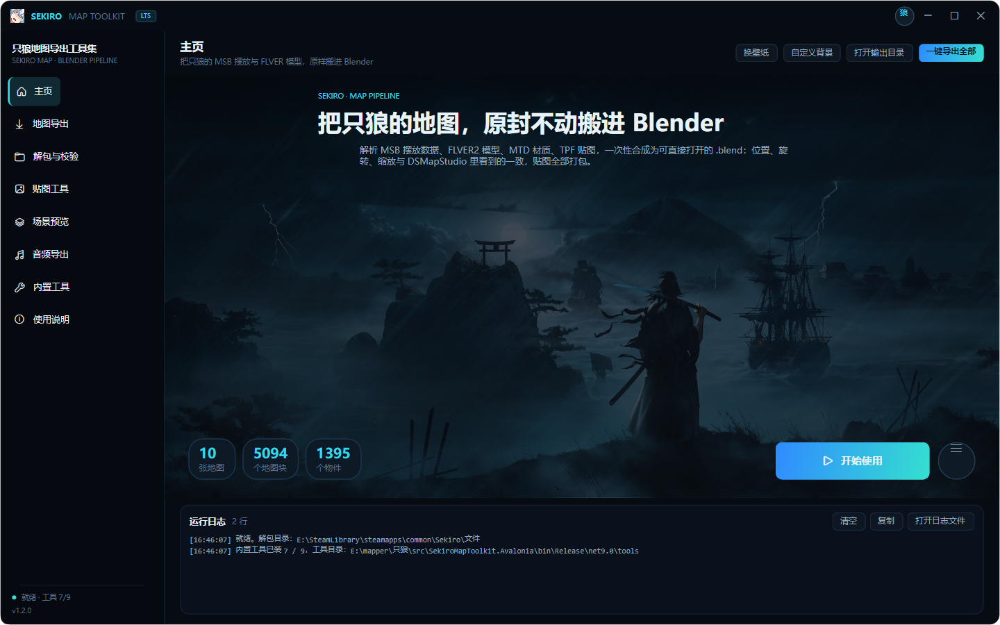

# 界面设计说明 · SEKIRO MAP TOOLKIT（Avalonia / MMT 风格）

> 参考 MMT 的"左侧导航 + 右侧原画"骨架，落到只狼地图工具上：暗黑 Fluent、青蓝主色、一点荧光黄，
> 无边框圆角窗、毛玻璃面板、右下悬浮主按钮。技术栈 Avalonia 11 + XAML，纯手写样式（不依赖第三方皮肤库）。

| 主页 | 内置工具 |
|---|---|
|  |  |

---

## 1. 设计定位

| 项 | 决定 |
|---|---|
| 气质 | 游戏逆向工具：硬核、冷静、科技感，二次元原画做底但压暗，不抢控件 |
| 主色 | 青蓝 `#35D6E8`（选中/进度/数据），辅助渐变 `#2F8BFF → #35E0D0`（只有主按钮用） |
| 点缀 | 荧光黄 `#F2D65C`，只给"提示/注意"用，绝不大面积铺 |
| 底色 | 近黑蓝 `#070B12`，卡片比底色亮一档，靠 1px 冷色描边分层，不用大阴影 |
| 字号 | 标题 34 / 页标题 17 / 分区 13 / 正文 12 / 日志 11（等宽） |
| 圆角 | 窗口 14，卡片 12，按钮 8～10，进度条 3 —— 越小的元素圆角越小 |
| 动效 | 只做 hover/active 的 0.12s 背景与前景过渡；不弹窗、不缩放、不飞入 |

---

## 2. 布局思路

### 2.1 骨架尺寸（1440 × 900 基准，最小 1180 × 720）

```
┌──────────────────────────────────────────────────────────────┐  44 标题栏（自绘）
├───────────────┬──────────────────────────────────────────────┤
│               │  62 页头：标题 + 副标题   [换壁纸][自定义背景][打开输出目录][一键导出全部]
│   236 侧边栏   ├──────────────────────────────────────────────┤
│   Logo/版本    │   ╔══════════════════════════════════════╗    │
│   8 个导航项   │   ║  页面宿主：整块壁纸 + 压暗遮罩 + 8 页 ║    │
│   …           │   ╚══════════════════════════════════════╝    │
│   底部状态     ├──────────────────────────────────────────────┤
│               │  158 运行日志（全页面共享）                     │
└───────────────┴──────────────────────────────────────────────┘
```

### 2.2 为什么这样切

1. **导航固定左侧 236px**：工具只有 7 个功能面，不需要折叠菜单；固定宽度让每次都点在同一位置，肌肉记忆。
2. **页头只放"当前页名 + 一句话说明"**：用户永远知道自己点进了哪；右侧三个全局动作（换壁纸、打开输出、一键导出全部）在任何页面都能用，避免"必须先回导出页"的断头路。
3. **日志常驻底部、全页面共享**：导出/贴图/预览/下载工具都会写日志，放在页面里就得复制四份；常驻一条 158px 的抽屉，任何操作都有回执。
4. **背景是一整块、不是每页一张**：`PageBg` 一张 Image + 一层 `PageDim` 遮罩铺满 `PageHost`，7 个页面共用；切页换图只改 `Source`，不用给每页各挂一张图，省内存也不闪。
5. **主页做成原画 Hero**：一进来先给"这是什么 + 开始使用"，统计条（地图/地图块/物件）用三枚 chip 快速交代数据规模；主按钮右下悬浮，符合 MMT 的视觉落点。
6. **卡片式分区**：路径、设置、执行三块独立卡片，各自 12px 圆角 + 1px 描边；不改密度，只改"块的边界"，扫读成本最低。

### 2.3 背景策略（这是 MMT 观感的关键）

| 层 | 做法 |
|---|---|
| 底图 | 20 张 1920×1080 手绘只狼插画（网络收集，非游戏截图、非 AI），预先统一调色：提饱和 → 自动曝光到平均亮度 0.17 → 轻微冷调 → 四角暗角 → JPEG q88 |
| 遮罩 | 一层纯色 `#C4070B12` 叠在底图上，不透明度 = `Config.BackgroundDim`（默认 0.70） |
| 顶部渐变 | 额外一层 70px 高的 `#B3050A10 → 透明`，让页头文字压得干净 |
| 面板 | 卡片 `#E00B121E`（88% 不透明），比遮罩再实一档，保证 12px 正文可读 |
| 轮换 | 启动随机换一张（不重复上一张）；挂机每 4 分钟自动换；「换壁纸」手动下一张 |
| 自定义 | 自定义图 > 渲染图 > 内置池，三个优先级在 `ApplyBackground()` 里依次判断 |

### 2.4 层级与配色分配

- 第 0 层：窗口底 `#070B12`
- 第 1 层：侧边栏 `#D9060A10`（比底色更冷更暗，形成"凹槽"）
- 第 2 层：壁纸 + 遮罩（背景永远在最底下，不参与交互）
- 第 3 层：卡片 `#E00B121E`（88% 不透明，透一点背景）
- 第 4 层：输入框 / 日志 `#0B121B`（实心，保证文字对比度）
- 前景：主文字 `#E8F3F9`，次文字 `#93A9BC`，弱提示 `#5C7186`
- 强调：选中底 `#0F2A33` + 3px 左侧竖条 `#38D7E8`；主按钮唯一使用渐变

---

## 3. 配色表

| 令牌 | 色值 | 用途 |
|---|---|---|
| `BgBase` | `#070B12` | 窗口底色 |
| `BgDeep` | `#05080E` | 最深底（日志/凹陷区） |
| `Panel` | `#0E1620`（86% α） | 卡片 |
| `PanelSolid` | `#0B121B` | 输入框、下拉、日志底 |
| `Line` | `#1B2A3B` | 卡片/输入框描边 |
| `LineSoft` | `#142334` | 卡片描边（更弱） |
| `Accent` | `#35D6E8` | 主青：选中文字、进度、数据数字 |
| `Accent2` | `#2F8BFF` | 渐变起点（蓝） |
| `AccentGlow` | `#35E0D0` | 渐变终点（青绿） |
| `NavActive` | `#0F2A33` | 导航选中底 |
| `NavHover` | `#131F2B` | 导航悬停底 |
| `AccentDim` | `#1E4B57` | 文本选区 |
| `TextPrimary` | `#E8F3F9` | 主文字 |
| `TextSecondary` | `#93A8BA` | 次文字 |
| `TextMuted` | `#5D7387` | 弱提示 / 日志 |
| `Warn` | `#F2D65C` | 荧光黄点缀（警告、限制提示） |
| `Danger` | `#FF6B6B` | 失败、缺贴图 |
| `CloseHover` | `#5A1D24` | 关闭按钮悬停底 |
| `Overlay` | `#C4070B12` | 底图上的深色遮罩（不透明度由 `BackgroundDim` 控制） |

**渐变**：`LinearGradientBrush` 135°，`#2F8BFF 0% → #35E0D0 100%`，只用于 `.primary` 按钮与进度条前景。

**字体**：`Inter, Microsoft YaHei UI, Segoe UI`；图标字体 `Segoe Fluent Icons, Segoe MDL2 Assets`（Win11 自带，无需打包）。

---

## 4. 资源结构

```
src\SekiroMapToolkit.Avalonia\
├─ SekiroMapToolkit.Avalonia.csproj    ← Avalonia 11.2.3 + Desktop + Fluent + Inter
├─ Program.cs                          ← 入口：--cli 无头导出 / --shot 截图 / 默认 GUI
├─ Cli.cs                              ← 命令行：地图导出 + 内置工具安装
├─ App.axaml / App.axaml.cs            ← 全局 ResourceDictionary（所有色令牌）
├─ Styles\Theme.axaml                  ← 全部控件样式（按钮/卡片/输入/进度 + 焦点框关闭）
├─ MainWindow.axaml                    ← 窗口骨架 + 共享背景层 + 7 个页面
├─ MainWindow.axaml.cs                 ← 导航、背景轮换、导出、校验、贴图、预览、工具下载、日志
├─ Assets\
│   ├─ app.ico                         ← exe 图标（16/24/32/48/64/128/256）
│   └─ app.png                         ← 窗口/标题栏用 128px 图标
└─ Resources\bg\
    ├─ bg_01.jpg … bg_20.jpg           ← 20 张 1920×1080 壁纸（已统一压暗调色）

..\SekiroMapToolkit\Core\              ← 两个 UI 共用（导出引擎，与界面无关）
    SekiroExporter.cs / Axis.cs / Souls.cs / BlenderRunner.cs
    Config.cs / ToolCatalog.cs / Models.cs / Oodle.cs
```

- 所有图片走 `AvaloniaResource`，用 `avares://SekiroMapToolkit/Resources/bg/bg_07.jpg` 引用；
- 单文件发布时图片与样式编译进 exe，`scripts\` 与 `oo2core_6_win64.dll` 留在 exe 同级（Blender 脚本必须能被外部进程读到）；
- `tools\` 由 `ToolCatalog` 在运行时创建，装的东西不进 git。

---

## 5. XAML 框架代码

### 5.1 App.axaml —— 色令牌集中在这

```xml
<Application xmlns="https://github.com/avaloniaui"
             xmlns:x="http://schemas.microsoft.com/winfx/2006/xaml"
             x:Class="SekiroMapToolkit.App"
             RequestedThemeVariant="Dark">
  <Application.Resources>
    <ResourceDictionary>
      <SolidColorBrush x:Key="BgBase"        Color="#070B12"/>
      <SolidColorBrush x:Key="BgDeep"        Color="#05080E"/>
      <SolidColorBrush x:Key="Panel"         Color="#CC0E1620"/>
      <SolidColorBrush x:Key="PanelSolid"    Color="#0B121B"/>
      <SolidColorBrush x:Key="Line"          Color="#1B2A3B"/>
      <SolidColorBrush x:Key="LineSoft"      Color="#142334"/>
      <SolidColorBrush x:Key="Accent"        Color="#35D6E8"/>
      <SolidColorBrush x:Key="AccentDim"     Color="#1E4B57"/>
      <SolidColorBrush x:Key="NavActive"     Color="#0F2A33"/>
      <SolidColorBrush x:Key="NavHover"      Color="#131F2B"/>
      <SolidColorBrush x:Key="TextPrimary"   Color="#E8F3F9"/>
      <SolidColorBrush x:Key="TextSecondary" Color="#93A8BA"/>
      <SolidColorBrush x:Key="TextMuted"     Color="#5D7387"/>
      <SolidColorBrush x:Key="Warn"          Color="#F2D65C"/>
      <SolidColorBrush x:Key="Danger"        Color="#FF6B6B"/>

      <LinearGradientBrush x:Key="AccentGradient" StartPoint="0%,0%" EndPoint="100%,100%">
        <GradientStop Color="#2F8BFF" Offset="0"/>
        <GradientStop Color="#35E0D0" Offset="1"/>
      </LinearGradientBrush>
    </ResourceDictionary>
  </Application.Resources>

  <Application.Styles>
    <FluentTheme />
    <StyleInclude Source="avares://SekiroMapToolkit/Styles/Theme.axaml"/>
  </Application.Styles>
</Application>
```

### 5.2 Theme.axaml —— 三个关键选择器

```xml
<!-- 导航项：透明底、左对齐、选中时 3px 青条 -->
<Style Selector="Button.nav">
  <Setter Property="Background" Value="Transparent"/>
  <Setter Property="BorderThickness" Value="0"/>
  <Setter Property="BorderBrush" Value="{DynamicResource Accent}"/>
  <Setter Property="HorizontalContentAlignment" Value="Left"/>
  <Setter Property="Height" Value="42"/>
  <Setter Property="CornerRadius" Value="8"/>
  <Setter Property="Foreground" Value="{DynamicResource TextSecondary}"/>
</Style>
<Style Selector="Button.nav:pointerover">
  <Setter Property="Background" Value="{DynamicResource NavHover}"/>
  <Setter Property="Foreground" Value="{DynamicResource TextPrimary}"/>
</Style>
<Style Selector="Button.nav.active">
  <Setter Property="Background" Value="{DynamicResource NavActive}"/>
  <Setter Property="Foreground" Value="{DynamicResource Accent}"/>
  <Setter Property="BorderThickness" Value="3,0,0,0"/>
</Style>

<!-- 主按钮：全程序唯一渐变 -->
<Style Selector="Button.primary">
  <Setter Property="Background" Value="{DynamicResource AccentGradient}"/>
  <Setter Property="Foreground" Value="#041018"/>
  <Setter Property="BorderThickness" Value="0"/>
  <Setter Property="CornerRadius" Value="10"/>
  <Setter Property="FontWeight" Value="SemiBold"/>
</Style>
<Style Selector="Button.primary:pointerover"><Setter Property="Opacity" Value="0.9"/></Style>

<!-- 卡片 -->
<Style Selector="Border.card">
  <Setter Property="Background" Value="{DynamicResource Panel}"/>
  <Setter Property="BorderBrush" Value="{DynamicResource LineSoft}"/>
  <Setter Property="BorderThickness" Value="1"/>
  <Setter Property="CornerRadius" Value="12"/>
  <Setter Property="Padding" Value="16"/>
</Style>
```

### 5.3 MainWindow.axaml —— 窗口与侧边栏

```xml
<Window x:Class="SekiroMapToolkit.UI.MainWindow"
        Width="1440" Height="900" MinWidth="1200" MinHeight="760"
        SystemDecorations="None"
        ExtendClientAreaToDecorationsHint="True"
        TransparencyLevelHint="Mica,Blur,Transparent"
        Background="Transparent"
        WindowStartupLocation="CenterScreen"
        FontFamily="Inter, Microsoft YaHei UI, Segoe UI">

  <Border x:Name="Shell" CornerRadius="14" ClipToBounds="True"
          Background="{DynamicResource BgBase}"
          BorderBrush="#1BFFFFFF" BorderThickness="1">
    <Grid RowDefinitions="44,*">

      <!-- 自绘标题栏：拖拽区 + 窗口按钮 -->
      <Grid Grid.Row="0" ColumnDefinitions="Auto,*,Auto"
            PointerPressed="TitleBar_PointerPressed">
        <StackPanel Orientation="Horizontal" Margin="14,0,0,0" Spacing="10">
          <Image Source="avares://SekiroMapToolkit/Assets/app.png" Width="20" Height="20"/>
          <TextBlock Text="SEKIRO" Foreground="{DynamicResource Accent}" FontSize="12" FontWeight="Bold"/>
          <TextBlock Text="MAP TOOLKIT" FontSize="12" Foreground="{DynamicResource TextSecondary}"/>
        </StackPanel>
        <StackPanel Grid.Column="2" Orientation="Horizontal" Margin="0,0,10,0"
                    VerticalAlignment="Center" Spacing="2">
          <Button Classes="chrome" Content="&#xE921;" Click="Min_Click"/>
          <Button Classes="chrome" Content="&#xE922;" Click="Max_Click"/>
          <Button Classes="chrome close" Content="&#xE8BB;" Click="Close_Click"/>
        </StackPanel>
      </Grid>

      <!-- 主体：侧边栏 + 内容 -->
      <Grid Grid.Row="1" ColumnDefinitions="232,*">
        <Border Grid.Column="0" Background="#B80A1118"
                BorderBrush="{DynamicResource LineSoft}" BorderThickness="0,0,1,0">
          <Grid RowDefinitions="Auto,*,Auto">
            <!-- Logo 区 -->
            <StackPanel Margin="18,16,16,8" Spacing="2">
              <TextBlock Text="只狼地图导出工具集" FontSize="13" FontWeight="SemiBold"/>
              <TextBlock Text="SEKIRO MAP · BLENDER PIPELINE" Classes="hint" FontSize="10.5"/>
            </StackPanel>
            <!-- 导航：Tag 即页号 -->
            <StackPanel Grid.Row="1" Margin="10,8">
              <Button Classes="nav active" Tag="0" Click="Nav_Click">
                <StackPanel Orientation="Horizontal" Spacing="10">
                  <TextBlock Text="&#xE80F;" FontFamily="Segoe Fluent Icons, Segoe MDL2 Assets" FontSize="14"/>
                  <TextBlock Text="主页" VerticalAlignment="Center"/>
                </StackPanel>
              </Button>
              <Button Classes="nav" Tag="1" Click="Nav_Click"> …地图导出… </Button>
              <Button Classes="nav" Tag="2" Click="Nav_Click"> …解包与校验… </Button>
              <Button Classes="nav" Tag="3" Click="Nav_Click"> …贴图工具… </Button>
              <Button Classes="nav" Tag="4" Click="Nav_Click"> …场景预览… </Button>
              <Button Classes="nav" Tag="5" Click="Nav_Click"> …音频导出… </Button>
              <Button Classes="nav" Tag="6" Click="Nav_Click"> …内置工具… </Button>
              <Button Classes="nav" Tag="7" Click="Nav_Click"> …使用说明… </Button>
            </StackPanel>
            <!-- 底部状态 -->
            <StackPanel Grid.Row="2" Margin="18,10,16,14" Spacing="4">
              <TextBlock Text="就绪 · 单文件版 v1.0.0" Classes="hint" FontSize="10.5"/>
            </StackPanel>
          </Grid>
        </Border>

        <Grid Grid.Column="1" RowDefinitions="62,*,158">
          <!-- 页头 -->
          <Grid Margin="24,0,24,0" ColumnDefinitions="*,Auto">
            <StackPanel VerticalAlignment="Center" Spacing="3">
              <TextBlock x:Name="PageTitle" Text="主页" FontSize="18" FontWeight="SemiBold"/>
              <TextBlock x:Name="PageSub" Classes="hint" FontSize="11.5" TextTrimming="CharacterEllipsis"/>
            </StackPanel>
            <StackPanel Grid.Column="1" Orientation="Horizontal" Spacing="8" VerticalAlignment="Center">
              <Button Classes="ghost small" Content="打开输出目录" Click="OpenOutput_Click"/>
              <Button Classes="primary small" Content="一键导出全部" Click="ExportAll_Click"/>
            </StackPanel>
          </Grid>

          <!-- 页面宿主 -->
          <Grid Grid.Row="1" x:Name="PageHost" Margin="20,0,20,0">
            <Grid x:Name="PageHome"> …Hero 原画 + 遮罩 + 统计 chip + 悬浮按钮… </Grid>
            <Grid x:Name="PageExport" IsVisible="False"> …地图列表 / 路径 / 设置 / 执行… </Grid>
            <Grid x:Name="PageUnpack" IsVisible="False"> … </Grid>
            <Grid x:Name="PageTex"    IsVisible="False"> … </Grid>
            <Grid x:Name="PagePreview" IsVisible="False"> … </Grid>
            <Grid x:Name="PageAudio" IsVisible="False"> … 音库清单 / 路径 / 码率 / 执行… </Grid>
            <Grid x:Name="PageTools"  IsVisible="False"> … </Grid>
            <Grid x:Name="PageAbout"  IsVisible="False"> … </Grid>
          </Grid>

          <!-- 日志 -->
          <Border Grid.Row="2" Classes="card" Margin="20,8,20,14" Padding="12,8">
            <Grid RowDefinitions="Auto,*">
              <Grid ColumnDefinitions="*,Auto">
                <TextBlock x:Name="LogCount" Text="运行日志" Classes="hint"/>
                <StackPanel Grid.Column="1" Orientation="Horizontal" Spacing="6">
                  <Button Classes="ghost small" Content="清空" Click="ClearLog_Click"/>
                  <Button Classes="ghost small" Content="复制" Click="CopyLog_Click"/>
                  <Button Classes="ghost small" Content="打开日志文件" Click="OpenLogFile_Click"/>
                </StackPanel>
              </Grid>
              <ScrollViewer Grid.Row="1" x:Name="LogScroll" Margin="0,4,0,0">
                <SelectableTextBlock x:Name="LogText" FontFamily="Consolas, Microsoft YaHei UI" FontSize="11"
                                     Foreground="{DynamicResource TextSecondary}"/>
              </ScrollViewer>
            </Grid>
          </Border>
        </Grid>
      </Grid>
    </Grid>
  </Border>
</Window>
```

### 5.4 背景层 + 主页 Hero —— 共用一块底图 + 右下悬浮按钮

```xml
<!-- 页面宿主：一张背景图 + 压暗遮罩，8 页共用；切页只改 PageBg.Source -->
<Grid Grid.Row="1" x:Name="PageHost" ClipToBounds="True">
  <Image x:Name="PageBg" Stretch="UniformToFill"
         RenderOptions.BitmapInterpolationMode="HighQuality"/>
  <Border x:Name="PageDim" Background="#C4070B12"/>   <!-- Opacity = Config.BackgroundDim -->
  <Border VerticalAlignment="Top" Height="70" IsHitTestVisible="False">
    <Border.Background>
      <LinearGradientBrush StartPoint="0%,0%" EndPoint="0%,100%">
        <GradientStop Color="#B3050A10" Offset="0"/>
        <GradientStop Color="#00050A10" Offset="1"/>
      </LinearGradientBrush>
    </Border.Background>
  </Border>

  <!-- 主页：只有内容，没有自己的底图 -->
  <Grid x:Name="PageHome">
    <Grid RowDefinitions="Auto,*,Auto" Margin="34,24,34,26">
      <StackPanel Spacing="9" MaxWidth="760">
        <TextBlock Text="SEKIRO · MAP PIPELINE" Foreground="{DynamicResource Accent}" FontSize="10.5"/>
        <TextBlock Text="把只狼的地图，原封不动搬进 Blender" Classes="h1"/>
        <TextBlock Classes="sub" MaxWidth="640"
                   Text="解析 MSB 摆放数据、FLVER2 模型、MTD 材质、TPF 贴图，一次性合成为可直接打开的 .blend；位置、旋转、缩放与 DSMapStudio 里看到的一致，贴图全部打包。"/>
      </StackPanel>

      <StackPanel Grid.Row="2" Orientation="Horizontal" Spacing="10" VerticalAlignment="Bottom">
        <Border Classes="chip"><StackPanel Spacing="1">
          <TextBlock x:Name="HomeMapCount" Text="—" Classes="num"/>
          <TextBlock Text="张地图" Classes="hint"/></StackPanel></Border>
        <!-- 地图块 / 物件 同理 -->
      </StackPanel>

      <StackPanel Grid.Row="2" Orientation="Horizontal" Spacing="12"
                  HorizontalAlignment="Right" VerticalAlignment="Bottom">
        <Button Classes="primary" Height="54" Width="222" Click="StartFromHome_Click">
          <StackPanel Orientation="Horizontal" Spacing="11">
            <TextBlock Text="&#xE768;" FontFamily="Segoe Fluent Icons, Segoe MDL2 Assets" FontSize="15"/>
            <TextBlock Text="开始使用" FontSize="15" FontWeight="SemiBold"/>
          </StackPanel>
        </Button>
        <Button Classes="round" Width="54" Height="54" Content="&#xE700;"
                FontFamily="Segoe Fluent Icons, Segoe MDL2 Assets" Click="QuickMenu_Click"/>
      </StackPanel>
    </Grid>
  </Grid>
</Grid>
```

背景切换（`MainWindow.axaml.cs`）：

```csharp
void ApplyBackground(int page)
{
    // 1) 自定义图  2) 关闭  3) 导出渲染图  4) 内置池
    if (!string.IsNullOrWhiteSpace(_cfg.BackgroundImage) && File.Exists(_cfg.BackgroundImage))
    { PageBg.Source = LoadBitmap(_cfg.BackgroundImage); PageDim.Opacity = _cfg.BackgroundDim; return; }
    if (_cfg.BackgroundMode == "off") { PageBg.Source = null; return; }
    if (_cfg.BackgroundMode == "render" && FindRenderBackdrop() is string r)
    { PageBg.Source = LoadBitmap(r); PageDim.Opacity = _cfg.BackgroundDim; return; }

    var idx = _cfg.BackgroundIndex;
    if (idx < 0 || idx >= Wallpapers.Length) idx = Rng.Next(Wallpapers.Length);
    PageBg.Source = LoadBitmapFromResource("avares://SekiroMapToolkit/Resources/bg/" + Wallpapers[idx]);
    PageDim.Opacity = _cfg.BackgroundDim;
}

// 挂机轮换：4 分钟换一张，不打断自定义图 / 渲染图
_bgTimer.Tick += (_, __) => AutoRotateBackdrop();

### 5.5 导出页 —— 左列表 + 右三卡

```xml
<Grid x:Name="PageExport" IsVisible="False" ColumnDefinitions="*,352">
  <Border Grid.Column="0" Classes="card" Padding="0" Margin="0,0,14,0">
    <Grid RowDefinitions="Auto,*">
      <Grid Margin="16,12,16,4" ColumnDefinitions="*,Auto">
        <TextBlock x:Name="MapCount" Text="地图列表" Classes="section" VerticalAlignment="Center"/>
        <StackPanel Grid.Column="1" Orientation="Horizontal" Spacing="6" Margin="8,0,0,0">
          <Button Classes="ghost small" Content="全选" Click="SelectAll_Click"/>
          <Button Classes="ghost small" Content="反选" Click="Invert_Click"/>
          <Button Classes="ghost small" Content="刷新" Click="RefreshMaps_Click"/>
        </StackPanel>
      </Grid>
      <ScrollViewer Grid.Row="1">
        <StackPanel x:Name="MapList" Margin="8,4,8,12" Spacing="2"/>
      </ScrollViewer>
    </Grid>
  </Border>

  <StackPanel Grid.Column="1" Spacing="12">
    <Border Classes="card"> <!-- 路径：解包目录 / 输出目录 / Blender --> </Border>
    <Border Classes="card"> <!-- 设置：限制模型数 + 3 个勾选 --> </Border>
    <Border Classes="card"> <!-- 执行：开始导出 / 取消 / 进度 / 状态 --> </Border>
  </StackPanel>
</Grid>
```

---

## 6. 交互细节（代码后置里做的事）

| 行为 | 实现 |
|---|---|
| 拖动窗口 | 标题栏 `PointerPressed` → `BeginMoveDrag(e)`；双击切换最大化 |
| 边缘缩放 | `Shell_PointerPressed` 命中 6px 内边距 → `BeginResizeDrag(WindowEdge.North/East/…)`（Avalonia 枚举是 NorthWest/North/…，不是 Left/Top） |
| 最大化 | 最大化时 `Shell.CornerRadius = 0`，还原时回 14；按钮字形同步 `\uE922` / `\uE923` |
| 焦点框 | **必须关**：`Button/TextBox/ComboBox/CheckBox/NumericUpDown` 的 `FocusAdorner="{x:Null}"`，否则截图里按钮外会多一圈白虚线框（Fluent 默认焦点视觉） |
| 导航切换 | `Tag` = 页号；`Classes.Set("active", …)` 加/去选中态；同步页头标题、副标题与背景 |
| 背景轮换 | 启动时 `RotateBackdropOnStart()` 随机换一张（不等于上次那张）；`DispatcherTimer` 每 4 分钟 `AutoRotateBackdrop()`；两个动作都跳过自定义图 / 渲染图 / 关闭状态 |
| 地图列表 | 每次 `RefreshMaps` 重新解析 `map\mapstudio\*.msb.dcx`，重建行；行内 hover 用 `PointerEntered/Exited` 改背景 |
| 日志 | worker 线程统一 `Dispatcher.UIThread.Post` 回主线程；只保留最近 2500 行，`ScrollViewer.ScrollToEnd()` 跟底 |
| 工具下载 | `ToolCatalog.InstallAsync`：`HttpClient` 带 PAT 流式下载（10% 一档回显）→ zip 用 `ZipFile`、7z 用 `System32\tar.exe`（`ArgumentList` 传参，避免中文路径乱码）→ `ResolveExe()` 递归找 exe → 写回 `config.json` |
| 取消 | `CancellationTokenSource` → 导出器按模型检查取消；Blender 子进程 `Kill(true)` 后返回 -2 |
| 空状态 | 预览页没有 `scene.json` 时给出"先跑一次导出"的引导，而不是空白面板 |
| 配置 | `config.json` 存在 exe 旁：路径、开关、上次勾选的地图、工具路径、壁纸模式与序号；关闭窗口时写回 |

---

## 7. 换肤与扩展

- **换壁纸**：直接把 1920×1080 的 jpg 丢进 `Resources\bg\` 并在 `MainWindow.axaml.cs` 的 `Wallpapers[]` 里加一行；
  想批量调色就用 `scripts\make_pool_wallpapers.py`（cover 裁切 → 提饱和 → 自动曝光到 0.17 → 冷调 → 暗角 → q88）。
  遮罩强度改 `Config.BackgroundDim` 默认值；运行时也能从「换壁纸 / 自定义背景」直接换。
- **换主色**：只改 `App.axaml` 里 `Accent / AccentBlue / Glow / NavActive` 四个值，全局生效；荧光黄 `Warn` 建议保留，作为唯一暖色点缀。
- **加页面**：`PageHost` 里加一个 `Grid x:Name="PageX" IsVisible="False"`，侧边栏加一条 `Tag="7"` 的 `.nav` 按钮，`ShowPage()` 的数组与 `Titles/Subs` 里加一项即可。
- **加内置工具**：`ToolCatalog.All` 里加一个 `ToolDef`（Key / Name / Repo / AssetUrl / ExeHints / Tag），UI 和 CLI 会自动带上。
- **不要做的**：大面积高斯模糊实时背景（Win10 会掉帧）、每个按钮独立阴影、超过 3 种强调色 —— 都会破坏"低调硬核"。

---

## 8. 编译

```bat
cd /d E:\mapper\只狼\src\SekiroMapToolkit.Avalonia
dotnet publish -c Release -r win-x64 --self-contained true ^
  -p:PublishSingleFile=true -p:IncludeNativeLibrariesForSelfExtract=true ^
  -p:EnableCompressionInSingleFile=true -o ..\..\_publish
```

产物：`SekiroMapToolkit.exe`（约 50 MB，自包含 .NET 9 + Avalonia 运行时，双击即用）。
自检：`SekiroMapToolkit.exe --shot out.png --page 1` 把任意页面渲染成 PNG（排查布局用，`--page 0..6`）。